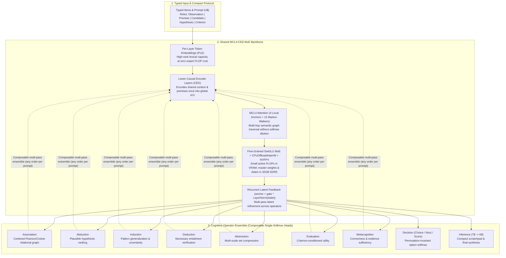

# MCL4-COE: Markov Chain Local-4 & Cognitive Operator Ensemble

**`MCL4-COE`** is a from-scratch cognitive architecture designed for consumer GPUs (**RTX 2050 4GB** validation -> **RTX 5070 12GB + 32GB DDR5 + 10TB NVMe** flagship training).

Instead of brute-forcing general intelligence through a monolithic dense transformer that must serialize every thought, correlation, and decision into a 150,000-word vocabulary softmax, `MCL4-COE` combines **multi-hop sparse graph attention (`MCL4`)**, a **Causal Encoder-Decoder (`CED`) MoE backbone**, and a **Composable Cognitive Operator Ensemble (`COE`)** that decomposes "thinking" into explicit, single-softmax latent operations.

---

## Core Thesis

Generalist LLMs waste 95% of their parameters memorizing static world trivia and suffer from three structural flaws when reasoning:
1. **Softmax Dilution in Dense Attention:** Summing over all $T$ context tokens dilutes attention weight across hundreds of irrelevant positions while requiring $K$ separate transformer layers to perform a $K$-hop relational lookup.
2. **Everything-is-Next-Token-Prediction:** Picking between typed options, correlating evidence, abstracting patterns, or estimating epistemic uncertainty forces a standard LLM to generate hundreds of English tokens—making its decisions slow, uncalibrated, and sensitive to option ordering.
3. **Active FLOPs Tied to Total Knowledge:** Dense models activate 100% of their weights on every token, chaining representational capacity to GPU VRAM and FLOP budgets.

`MCL4-COE` solves all three by unifying proven mechanisms from [`mini`](https://github.com/mESmaC/mini), `mcattn`, and [`oracle`](https://github.com/mESmaC/oracle) into a single clean-slate architecture:

---

## Repository Documentation Index

| Document | Summary |
| :--- | :--- |
| **[`docs/01_UNIFIED_ARCHITECTURE_SPEC.md`](docs/01_UNIFIED_ARCHITECTURE_SPEC.md)** | Full technical specification of the `MCL4` router, `CED` cross-attending encoder-decoder fix, `PLE`, `CPUOffloadAdamW` + `NVFP4`, and the mathematical definitions of all 9 `COE` cognitive operators. |
| **[`docs/02_WHY_COE_BEATS_GENERALIST_LLMS.md`](docs/02_WHY_COE_BEATS_GENERALIST_LLMS.md)** | Why decomposing thinking into composable single-softmax operators (`Decision`, `Association`, `Deduction`, `Abduction`, `Metacognition`) demonstrates frontier capabilities that 70B generalist LLMs cannot match. |
| **[`docs/03_HARDWARE_AND_TRAINING_ROADMAP.md`](docs/03_HARDWARE_AND_TRAINING_ROADMAP.md)** | Hardware physics for the **RTX 2050 (4GB)** and **RTX 5070 (12GB GDDR7 + 32GB DDR5 + 10TB NVMe)**, unlocking ~1 PFLOP Sparse NVFP4 during RL rollouts, and the 4-milestone implementation plan. |
| **[`docs/04_YYCORE_LAUNCH_BLUEPRINT.md`](docs/04_YYCORE_LAUNCH_BLUEPRINT.md)** | Proof-led research and self-serve commercialization roadmap for `yycore.ai`. |

---

## Empirical Foundations Already Proven Across Predecessor Repos

1. **`MCL4` (`markov_local_tokens: 4`) Beats Dense Attention (`mcattn`):**
   * On matched 1.1M-parameter initialization, training batches, and token budgets on TinyStories, reserving **4 local anchor positions + 12 bounded Markov-walked positions** (`16` attended tokens total out of `256`) achieved **`1.1832` nats/byte** (`1.1870 ± 0.0002` sampled) vs. **`1.2189` nats/byte** for standard dense 256-token attention.
2. **Block-Aligned `U$ / T$ / A$` Pretraining & Micro-Traces (`mini`):**
   * Using `CPUOffloadAdamW` + native BF16 + Triton FlexAttention on the 4GB RTX 2050 laptop, a 1M MoE model pretrained at **`583,000` byte tokens/sec** (`val_ce_loss = 1.2222` in 220s) and learned structured `U$ -> T$ -> A$` reasoning turns (`val_ce_loss = 1.1093` in 168s, `<800 MiB` VRAM) using `0x8000` high-bit prompt masking and zero cross-block truncation.
3. **Native Windows Blackwell `NVFP4` + Shared Multimodal/Cognitive Core (`oracle`):**
   * Demonstrated packed `E2M1` + `FP8 E4M3` block-scaled `cuBLASLt` GEMMs with stochastic gradient rounding and Hadamard transforms on Windows (`PyTorch + CUDA`), alongside `PLE`, `CED`, `RecurrentFeedback`, and typed cognitive readouts.
