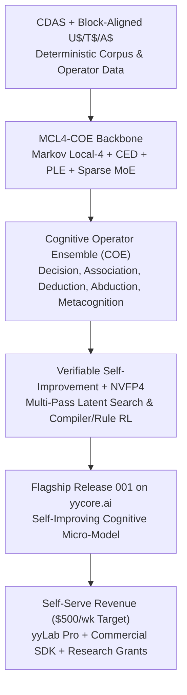

# 04. YY (`yycore.ai`) Launch Blueprint: Flagship `MCL4-COE` + The Foundry

> [!IMPORTANT]
> **The Goal:** Replace your day job by reaching **`$500`/week (`~$2,100`/month)** in net income with **zero sales calls**, working entirely in your element: **custom cognitive architectures (`MCL4-COE`), multi-hop sparse attention, routed micro-experts, and recursive self-improvement.**

---

## 1. Your Unfair Advantage & Unified Thesis

Across your repositories (`mini`, `mcattn`, `oracle`, `spalmer`, `stc`, `xerces`, `CDAS`, `yyLab`), you have built the pieces of a unified thesis that frontier labs ignore because they are locked into giant monolithic next-token predictors:

---

## 2. How You Hit `$500`/Week (`$2,100`/Month) Without Sales Calls

Because your target is `$2,100`/month—not `$20,000`/month—you can rely 100% on **Proof-Led Inbound** (publishing reproducible benchmarks and interactive trace visualizations on `yycore.ai`, `r/LocalLLaMA`, Hacker News, and Hugging Face) paired with **self-serve checkout and non-dilutive research grants**.

### Stream A: Commercial Embeddable `MCL4-COE` Decision & Reasoning SDK (`$49`–`$149`/mo)
* Developers building games, autonomous simulations, local coding tools, and deterministic triage pipelines need a **fast, permutation-invariant decision and correlation engine** (`Choice`, `Noul`, `Score`, `Association`, `Metacognition`) that runs in megabytes of RAM on any CPU/GPU without hallucinating or changing answers when options are reordered.
* Dual-license `MCL4-COE` weights and runtime:
  * **Free** for academic and non-commercial research.
  * **`$49`/mo (Indie) or `$149`/mo (Studio)** self-serve commercial license via Polar.sh / Stripe.
* **The Math:** **20 indie devs at `$49`/mo + 8 studios at `$149`/mo = `$2,172`/month**.

### Stream B: `yyLab Pro` + Pre-Built Cognitive Operator & RL Packs (`$25`/mo)
* Package the visual trace inspector (`mcattn/visualize.py`), operator training harness, and RTX 4GB–16GB `CPUOffloadAdamW` presets into `yyLab`.
* **The Math:** **85 subscribers at `$25`/month = `$2,125`/month**.

### Stream C: Non-Dilutive Research Grants & Free Scale-Up Compute (0% Equity, Written Application Only)
Once **Flagship Research Report `001` (`MCL4-COE`)** is live on `yycore.ai` showing:
1. `MCL4` beating dense attention (`1.1832` vs `1.2189`) with interactive Markov walk visualizations, and
2. `COE`'s composable single-softmax operators (`Decision`, `Association`, `Deduction`, `Abduction`, `Metacognition`) solving multi-step reasoning and calibrated abstention at 1M–50M parameters...

Submit that exact URL to:
1. **Google TPU Research Cloud (TRC):** 30–90 days of **32 to 128 Cloud TPUs completely free** to scale `MCL4-COE` to billions of parameters at `$0` hardware cost.
2. **Emergent Ventures (Mercatus Center):** Written application for independent zero-to-one researchers; typical grant size is **`$10,000` to `$40,000`** (5 to 18 months of your `$500`/week target).
