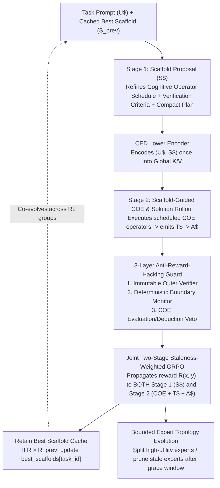

# 05. Ornith-Style Self-Scaffolding & Structural Self-Improvement in `MCL4-COE`

Inspired by [Ornith-1.0: Self-Scaffolding LLMs for Agentic Coding](https://ornith.ai/ornith_1_0.html) and the prototype RL/topology mechanics in [`mini`](https://github.com/mESmaC/mini) (`chat_rl.py` and `expert_lifecycle.py`), **`MCL4-COE` treats both its cognitive orchestration scaffold and its MoE expert topology as learnable objects that co-evolve with the model policy.**

---

## 1. Why Self-Scaffolding Is Even More Powerful Inside `MCL4-COE`

In a standard LLM (including Ornith-1.0's dense/MoE text models and `mini`'s ChatML prototype), a "scaffold" can only be a block of prompt text that instructs the model how to format its `<think>` monologue. In `mini/src/mini_moe/chat_rl.py`, quoting a previous plan inside ChatML required 6-character JSON escapes (`\u003c`) and consumed a large fraction of the 256/512-byte context window.

In **`MCL4-COE`**, the model has **9 explicit Cognitive Operators (`COE`)** (`Association`, `Abduction`, `Induction`, `Deduction`, `Abstraction`, `Evaluation`, `Metacognition`, `Decision`, `Inference`) and a **Causal Encoder-Decoder (`CED`)** backbone. Therefore, self-scaffolding operates at **three synergistic levels**:

---

## 2. Two-Stage Self-Scaffolding Protocol (`U$ -> S$ -> COE -> T$ -> A$`)

We extend the compact delimiter protocol with **`S$` (Scaffold)**:

### Stage 1: Scaffold Evolution (`(U$, S_prev) -> S$`)
1. **Scaffold Memory Cache (`best_scaffolds`):**
   * An off-GPU CPU/NVMe dictionary stores the highest-reward verified scaffold $S_{\text{prev}}$ discovered so far for each task ID or task family (`Association`-clustered task archetype), keyed by `(task_id, prompt_sha256, reward, scaffold_ids, operator_schedule)`.
2. **Proposing a Refined Scaffold:**
   * Conditioned on `<bos>U$ {task}\nS_prev$ {previous_scaffold}\n`, the model samples a group of $G$ candidate scaffolds $\{S^{(1)}, \dots, S^{(G)}\}$.
   * Each scaffold $S^{(g)}$ specifies:
     * **The Operator Schedule:** Which `COE` operators to run and in what order (e.g., `[Abduction -> Association -> Deduction -> Metacognition -> Inference]`), selected via the single-softmax `Decision` controller or compact operator tokens.
     * **The Task-Specific Strategy (`S$`):** A compact (`<= 32`–`64` token) plan, subgoal decomposition, or edge-case checklist tailored to the problem.

### Stage 2: Scaffold-Guided Solution Rollout (`(U$, S$) -> COE -> T$ -> A$`)
1. **Zero-Escape `CED` Conditioning:**
   * Instead of re-quoting $S^{(g)}$ inside a nested ChatML string, the lower `CED` encoder layers encode `<bos>U$ {task}\nS$ {scaffold}\n` **once** into global keys/values $(K_{\text{global}}, V_{\text{global}})$.
   * Inertness guarantee: $S^{(g)}$ is strictly conditioning state inside `CED`; generated scaffold text is never executed as shell/python code or allowed to touch the verifier.
2. **Guided Execution:**
   * The upper `CED` layers execute the scaffolded `COE` operators and generate the solution rollout `T$ {trace}\nA$ {answer}<eos>`.

---

## 3. Joint Credit Assignment & Staleness-Weighted Pipeline GRPO

When the immutable verifier scores the final answer $A^{(g)}$ with reward $R^{(g)} \in [-1, 1]$, group-normalized advantages are computed across the $G$ trajectories:
$$A^{(g)} = \frac{R^{(g)} - \mu_R}{\sigma_R + \epsilon}$$

### 3.1 Two-Stage Policy Gradient Propagation
Following Ornith-1.0 and `mini/src/mini_moe/chat_rl.py`:
* The **same advantage $A^{(g)}$** is propagated to **both**:
  1. **Stage 1 (`scaffold` tokens & operator routing decisions):** Teaching the model how to author better scaffolds $S\$$ and choose better `COE` operator sequences that elicit high-reward solutions.
  2. **Stage 2 (`answer` tokens & `COE` readouts):** Teaching the model how to execute a given scaffold $S\$$ into an accurate `T$ -> A$` solution.
* If $\max_g R^{(g)} > \max(0, R_{\text{cached}})$ and the scaffold is non-empty, `best_scaffolds[task_id]` is updated with the new winning scaffold $S^{(g^*)}$.

### 3.2 Ornith Staleness Weighting $w(d_t)$ for Async / Multi-Pass Rollouts
When combining fast **NVFP4 rollout generation** on the RTX 5070 with replay/pipeline RL updates, tokens or trajectories generated under an older policy snapshot $\pi_{\theta_t^{\text{beh}}}$ at policy age $d_t = v_{\text{current}} - v_{\text{beh}}$ are weighted by Ornith-1.0's staleness kernel:
$$w(d_t) = \begin{cases} 1, & \text{if } d_t \le K_1, \\ \exp\!\bigl(-\lambda (d_t - K_1)\bigr), & \text{if } K_1 < d_t \le K_2, \\ 0, & \text{if } d_t > K_2. \end{cases}$$
The token/operator clipped GRPO objective is:
$$\mathcal{L}_t = -\min\!\Bigl(r_t A_t,\; \text{clip}(r_t, 1 - \epsilon^-, 1 + \epsilon^+) A_t\Bigr) \cdot w(d_t), \quad r_t = \frac{\pi_\theta(y_t \mid x, y_{<t})}{\pi_{\theta_t^{\text{beh}}}(y_t \mid x, y_{<t})}$$
* Any rollout crossing a **topology mutation boundary** (`topology_version` increment from expert growth/pruning) receives $w(d_t) = 0$ (immediate invalidation, preserving `mini`'s strict topology safety invariant).

---

## 4. Three-Layer Defense Against Reward Hacking

Allowing a model to author its own scaffold (`S$`) introduces the classic reward-hacking risk: a scaffold might try to game the verifier, hardcode expected test outputs, or exploit grading heuristics. `MCL4-COE` implements Ornith-1.0's 3-layer defense natively:

1. **Layer 1 — Immutable Outer Trust Boundary:**
   * The task prompt, environment state, tool surface, and verification harness (`pytest`, `rustc`, symbolic math checker) live outside the model's writable memory.
   * The model can only mutate its **inner cognitive scaffold (`S$`)**: its operator schedule, `Meta-Attention` focus weights, working scratchpad (`T$`), and cached strategy.
2. **Layer 2 — Deterministic Boundary Monitor:**
   * Before any rollout reaches reward calculation, a deterministic monitor inspects both $S\$$ and $A\$$ for forbidden patterns (e.g., attempting to read withheld test files, modifying test assertions, emitting degenerate tautologies, or violating structural constraints).
   * Flagged trajectories are assigned **zero reward and excluded from group advantage normalization** so they cannot poison the baseline.
3. **Layer 3 — In-Network `COE` Entailment & Criterion Veto (Replacing the External LLM Judge):**
   * Where Ornith-1.0 requires a separate frozen LLM judge to veto intent-level gaming, `MCL4-COE` uses a **frozen reference snapshot of its own `Deduction` (`entailed` vs `contradicted`/`undetermined`) and `Evaluation` (criterion utility) operators**:
   * If a trajectory passes the external test suite by luck or shortcut (`A$` is right, but `Deduction` scores `T$ -> A$` as `undetermined` or `contradicted` relative to the premises/scaffold), the veto suppresses the reward bonus—forcing the model to earn rewards only when its reasoning trace `T$` genuinely entails `A$`.

---

## 5. Bounded Structural Self-Improvement (`ExpertLifecycle`)

Carried forward from [`mini/src/mini_moe/expert_lifecycle.py`](https://github.com/mESmaC/mini):
* **Training-Only Replay Observation:** Expert routing load is tracked exclusively during verified training replay (`observe_replay`), never during evaluation or speculative rollouts.
* **Speculative Expert Mitosis (`grow_experts`):** At `growth_interval` group boundaries (when `parameter_count < max_parameters`, `pending < max_pending`, and `recent_survival >= min_recent_survival`), the highest-EMA-usage expert slot is cloned/split with orthogonal perturbation and matched `CPUOffloadAdamW` state expansion.
* **Staleness Pruning (`prune_experts`):** Grown experts that survive their `grace_groups` window (`100` groups) but remain unused beyond `prune_after_groups` (`200` groups) are pruned cleanly from both the GPU working bank and CPU master/Adam buffers, while retaining their full audit record in `history` so failed births cannot artificially inflate survival statistics.
